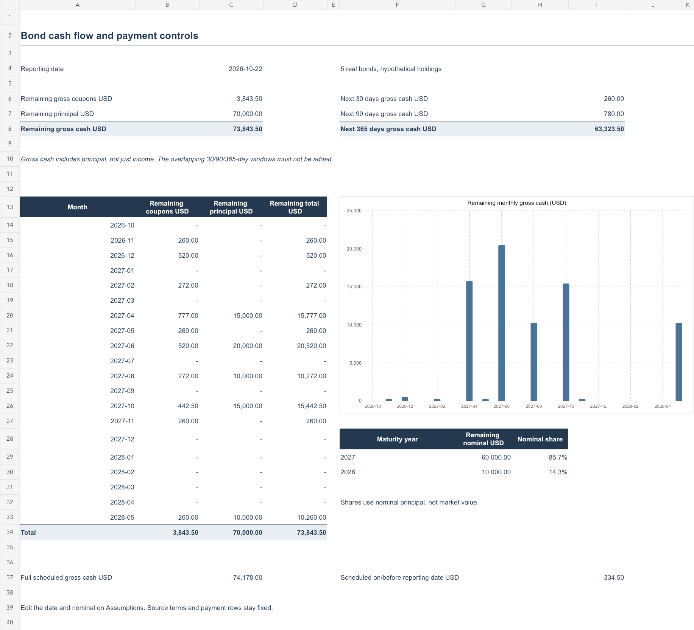

# Bond cash-flow report

**Browser-viewable report · USD · Reporting date: 22 October 2026**

This independent case uses the published terms and payment dates of five Turkish domestic government bonds. The nominal holdings are **hypothetical**, held constant from issue to maturity. Figures below are scheduled gross cash flows, not verified receipts, profit or investment advice.

## What the analysis answers

- **How much is scheduled after the reporting date?** USD **73,843.50**: USD 3,843.50 in coupons and USD 70,000 in returned principal.
- **What is due soon?** USD **260.00** in the next 30 days and USD **780.00** in the next 90 days. The 30-day period is inside the 90-day period; these amounts must not be added.
- **When does principal mature?** USD **60,000** (85.7% of assumed nominal) in 2027 and USD **10,000** (14.3%) in 2028.
- **Is a past scheduled payment counted as future cash?** No. The USD 334.50 coupon dated 14 October 2026 is excluded from remaining cash flows. Its payment has not been independently verified.

## Summary at 22 October 2026

| Measure | USD |
| --- | ---: |
| Hypothetical nominal holdings | 70,000.00 |
| Coupons across the complete schedule | 4,178.00 |
| Principal across the complete schedule | 70,000.00 |
| Complete scheduled gross cash flow | 74,178.00 |
| Remaining scheduled coupons | 3,843.50 |
| Remaining scheduled principal | 70,000.00 |
| **Remaining scheduled gross cash flow** | **73,843.50** |
| Next 30 days, gross | 260.00 |
| Next 90 days, gross | 780.00 |
| Next 365 days, gross | 63,323.50 |

The reporting date is fixed in this example; these windows do not move automatically with today's date. Gross cash flow includes returned principal and is **not investment return**. The 30-, 90- and 365-day windows overlap.

## Payment schedule

One row represents one scheduled coupon date. Principal appears on the instrument's final payment date. The first row is before the reporting date; all later rows are the **remaining schedule**.

| Payment date | Bond ISIN | Coupon USD | Principal USD | Total USD | Relative to reporting date |
| --- | --- | ---: | ---: | ---: | --- |
| 2026-10-14 | TRT140427F13 | 334.50 | 0.00 | 334.50 | Past scheduled |
| 2026-11-11 | TRT100528F15 | 260.00 | 0.00 | 260.00 | Remaining |
| 2026-12-09 | TRT090627F18 | 520.00 | 0.00 | 520.00 | Remaining |
| 2027-02-19 | TRT200827F11 | 272.00 | 0.00 | 272.00 | Remaining |
| 2027-04-07 | TRT061027F15 | 442.50 | 0.00 | 442.50 | Remaining |
| 2027-04-14 | TRT140427F13 | 334.50 | 15,000.00 | 15,334.50 | Remaining |
| 2027-05-12 | TRT100528F15 | 260.00 | 0.00 | 260.00 | Remaining |
| 2027-06-09 | TRT090627F18 | 520.00 | 20,000.00 | 20,520.00 | Remaining |
| 2027-08-20 | TRT200827F11 | 272.00 | 10,000.00 | 10,272.00 | Remaining |
| 2027-10-06 | TRT061027F15 | 442.50 | 15,000.00 | 15,442.50 | Remaining |
| 2027-11-10 | TRT100528F15 | 260.00 | 0.00 | 260.00 | Remaining |
| 2028-05-10 | TRT100528F15 | 260.00 | 10,000.00 | 10,260.00 | Remaining |

The [CSV payment table](payment_schedule.csv), [complete monthly calendar](monthly_calendar.csv) and [maturity concentration table](maturity_concentration.csv) can also be read directly on GitHub without downloading.

## Method and checks

The nominal amounts come from [hypothetical portfolio assumptions](../data/portfolio_assumptions.json). Coupon rates, dates and source references come from [sourced instrument facts](../data/source_facts.json). Each coupon equals assumed nominal multiplied by its **six-month periodic coupon rate**. Principal is added only at maturity. Payment dates follow the published schedules rather than a generated six-month date rule.

The supplied inputs pass the project's validation rules with **zero detected issues**. Nine separate invalid examples demonstrate errors the controls can catch; this does not prove all possible errors are detectable. The Python calculations, SQL queries and workbook were reconciled for the supplied scenario. [Business requirements](../docs/03_business_requirements.md), [manual acceptance scenarios](../docs/04_acceptance_tests.md) and [verification notes](../docs/05_results_and_verification.md) document the review process; manual business-user acceptance remains pending.

Official disclosures: [13 Apr 2026](https://ms.hmb.gov.tr/uploads/2026/04/140426-ABD-Dolari-cinsi-DIBS-274af14c0612bd0e.pdf), [11 May 2026](https://ms.hmb.gov.tr/uploads/2026/05/110526-ABD-Dolari-cinsi-DIBS-Kira-Sertifikasi-0a48964a698fb6f8.pdf), [5 Jun 2026](https://ms.hmb.gov.tr/uploads/2026/06/050626-ABD-Dolari-cinsi-DIBS-Kira-Sertifikasi-7f283325716cfea0.pdf), [19 Aug 2026](https://ms.hmb.gov.tr/uploads/2026/08/190826-ABD-Dolari-cinsi-DIBS-Kira-Sertifikasi-bbc387d22de5d984.pdf) and [5 Oct 2026](https://ms.hmb.gov.tr/uploads/2026/10/061027-ABD-Dolari-cinsi-DIBS-Kira-Sertifikasi-683a82c746d36ef2.pdf), page 1. Source URLs are also recorded alongside each instrument in the data file.

## Scope

This is a five-bond scenario, not a real investor account. All five bonds have the same issuer and currency. There are no purchase prices, trades, verified receipts, taxes, fees, FX conversions, yields, current market values or buy/sell recommendations. Nominal maturity shares do not measure market-value risk.

The [Excel workbook](bond_cashflow_report.xlsx) is available for reviewers who want to change the assumed amounts or reporting date, but **no download is needed to review this report**. See the [project overview](../README.md) for the code, SQL query map and reproduction steps.
